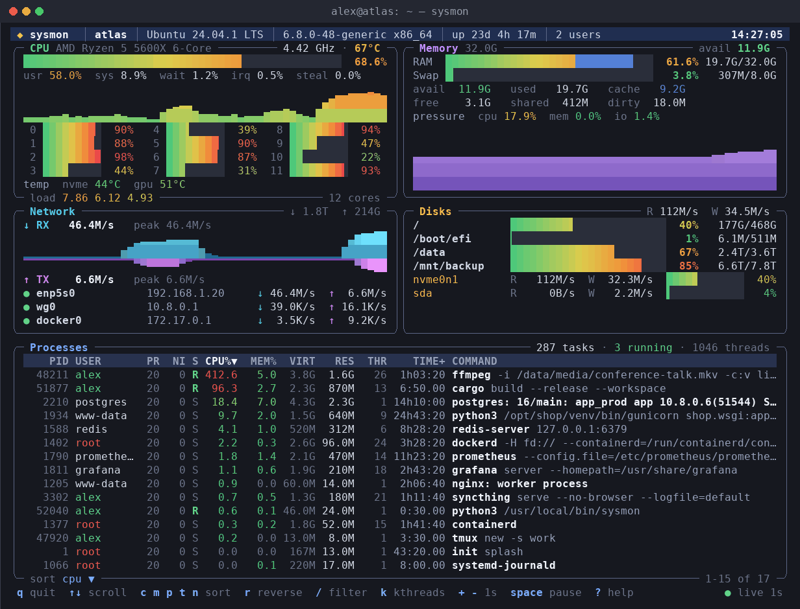

# sysmon

[Русский](README.ru.md) | **English**

A pretty live system monitor for the Linux console: CPU, memory, network, disks and processes on one screen. A single file with no dependencies that works over SSH and on a bare server console.



## What it shows

| Panel | Description |
| --- | --- |
| Header | Hostname, OS, kernel, uptime, login sessions, battery, clock |
| CPU | Total load split into usr/sys/iowait/irq/steal, history graph, per-core load, frequency, temperature, load average |
| Memory | RAM and swap like `free`: used, cache, available, pressure (PSI), history graph |
| Network | Receive and transmit speed with a graph and peaks, interfaces with IP addresses |
| Disks | Usage of every filesystem like `df`, read/write speed and utilisation of every disk |
| Processes | Process list like `top`: CPU, memory, CPU time, full command line |

## Requirements

- Linux
- Python 3.6+ (preinstalled on almost every distribution; no packages needed)

## Installation

```sh
curl -o sysmon https://raw.githubusercontent.com/nearbyall/sysmon/main/sysmon
chmod +x sysmon
./sysmon
```

To run it as `sysmon` from any directory:

```sh
sudo install -m 755 sysmon /usr/local/bin/sysmon
```

## Keys

| Key | Action |
| --- | --- |
| `q` | Quit |
| `↑` `↓` `PgUp` `PgDn` | Scroll the process list |
| `c` `m` `p` `t` `n` | Sort by CPU / memory / PID / time / name (press again to reverse) |
| `/` | Filter processes by name (`Esc` clears) |
| `k` | Show or hide kernel threads |
| `+` `-` | Refresh slower / faster |
| `Space` | Pause |
| `?` | Help |

## Options

| Option | Description |
| --- | --- |
| `-i SEC` | Refresh interval, 1 second by default |
| `-s cpu\|mem\|pid\|time\|name` | Initial sort order |
| `--once` | Print one snapshot and exit (also used automatically when the output is redirected) |
| `--ascii` | ASCII-only drawing for fonts without box and block characters |
| `--colors 16\|256\|truecolor` | Force the colour depth |

Colours and symbols adapt to the terminal automatically, including the Linux text console.
