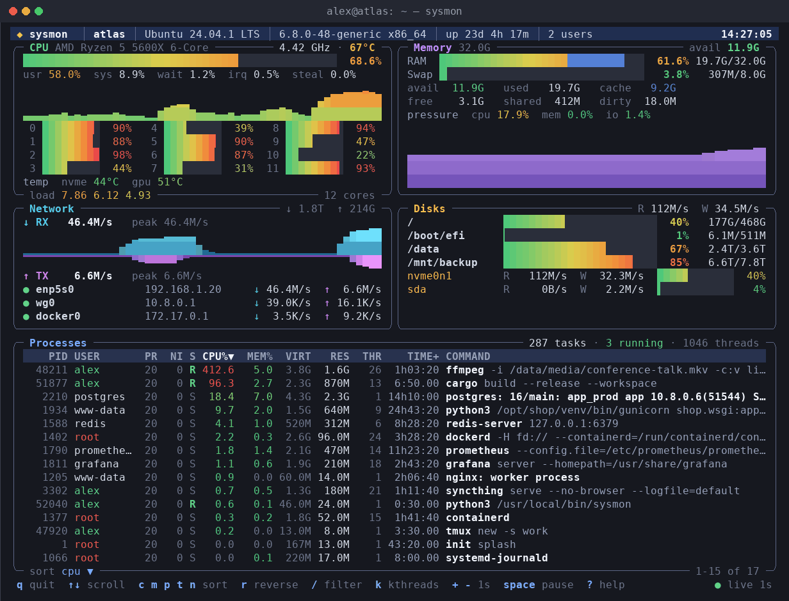

# sysmon

**Русский** | [English](README.md)

Красивый живой мониторинг Linux прямо в консоли: процессор, память, сеть, диски и процессы на одном экране. Один файл без зависимостей, работает по SSH и в текстовой консоли сервера.



## Что показывает

| Панель | Описание |
| --- | --- |
| Шапка | Имя машины, ОС, ядро, аптайм, число сессий, батарея, часы |
| CPU | Общая загрузка с разбивкой usr/sys/iowait/irq/steal, график, загрузка каждого ядра, частота, температура, load average |
| Memory | RAM и swap как в `free`: занято, кэш, доступно, давление (PSI), график |
| Network | Скорость приёма и отдачи с графиком и пиками, интерфейсы с IP-адресами |
| Disks | Заполненность разделов как в `df`, скорость чтения/записи и загрузка каждого диска |
| Processes | Список процессов как в `top`: CPU, память, процессорное время, полная команда |

## Требования

- Linux
- Python 3.6+ (уже установлен почти во всех дистрибутивах; пакеты не нужны)

## Установка

Установите как команду `sysmon`, которая работает из любой папки:

```sh
sudo curl -fsSL -o /usr/local/bin/sysmon https://raw.githubusercontent.com/nearbyall/sysmon/main/sysmon
sudo chmod +x /usr/local/bin/sysmon
sysmon
```

Чтобы обновить, выполните те же две команды ещё раз. Удалить: `sudo rm /usr/local/bin/sysmon`.

Попробовать без установки:

```sh
curl -fsSL -o sysmon https://raw.githubusercontent.com/nearbyall/sysmon/main/sysmon
sh sysmon
```

## Клавиши

| Клавиша | Действие |
| --- | --- |
| `q` | Выход |
| `↑` `↓` `PgUp` `PgDn` | Прокрутка списка процессов |
| `c` `m` `p` `t` `n` | Сортировка по CPU / памяти / PID / времени / имени (повторное нажатие переворачивает) |
| `/` | Поиск процесса по имени (`Esc` сбрасывает) |
| `k` | Показать или скрыть потоки ядра |
| `+` `-` | Обновлять реже / чаще |
| `Пробел` | Пауза |
| `?` | Справка |

## Параметры

| Параметр | Описание |
| --- | --- |
| `-i СЕК` | Интервал обновления, по умолчанию 1 секунда |
| `-s cpu\|mem\|pid\|time\|name` | Начальная сортировка |
| `--once` | Вывести один снимок и выйти (включается сам, если вывод перенаправлен) |
| `--ascii` | Только ASCII-символы, для шрифтов без рамок и блоков |
| `--colors 16\|256\|truecolor` | Принудительная глубина цвета |

Цвета и символы подстраиваются под терминал автоматически, включая текстовую консоль Linux.
